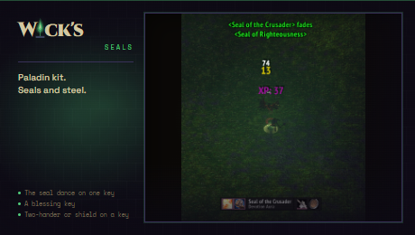

# Wick's Seals and Things

<!-- wick:badges:start -->

<!-- wick:badges:end -->

The paladin kit for **World of Warcraft: Forever**, built on
[WickCore](https://github.com/Wicks-mods/WickCore).

A paladin's loadout is a seal, a blessing, an aura and the weapon in
hand. This kit puts the seal dance on one key, your blessing on
another, says which seal and aura are on you, and gives you two keys to
swap between your two-hander and your shield.

## What it does

**Seal strip.** One 30px row: the seal key, the blessing key, two lines
saying which seal and aura are up, and the two weapon swap keys. The
seal key is ringed in fel green while a seal is on you. Shift-drag moves
it even when locked.

Nothing on the strip is a list written down from Classic. Which seals,
blessings and auras exist comes from your spellbook, so a seal Forever
renames or retunes shows up as itself.

**The seal key.** Back and forth, the way Totems and Things twists
totems: Seal of the Crusader on the first press, your fighting seal on
the next, the Crusader again after that. Judge the Crusader with
whatever you judge with. It goes back to the Crusader after 27 quiet
seconds, which is about what a judgement lasts, and when combat ends,
so every fight opens on the Crusader. The fighting seal is the last
seal you fought under, kept after it fades, or Seal of Righteousness
before you have cast one. `/wsl seal <name>` fixes it to one seal.
`/wsl cycle <spell, spell>` sets your own steps, `/wsl cycle reset
<seconds>` the quiet time.

**Blessing key.** Casts your blessing on a friendly target, or on you
with none. It follows the blessing that is on you, or the one you name
with `/wsl bless <name>`; a Greater Blessing works if that is what you
name. Lit while that blessing is on you.

**Weapon swap keys.** Two keys, tied to nothing. One puts your
two-hander in your hands, the other your one-hander and shield. They
remember what you last wore, so a new weapon needs nothing done to it
beyond putting it on once, and they name every piece by item id so two
maces called the same thing cannot pick the wrong one. With nothing
remembered they take the best piece you carry; `/wsl pin 2h` with an
item link makes a key reach for one piece and no other. Each macro
names where the set should end up rather than describing a move, so
pressing a key twice does nothing the second time. The strip shows the
piece each key puts on, with a mark on the set you are already wearing.

Worth knowing before you bind them: swapping resets your swing timer.

**Pre-pull checklist.** A seal on, a blessing on you, an aura up,
Symbols of Kings once you know a Greater Blessing, a Symbol of Divinity
once you know Divine Intervention, and Righteous Fury when you say you
tank (`/wsl fury on`). Read out of combat, from your own auras and bags.

**Talents, racials and a cooldown bar** through WickCore, the same as
every other kit.

## Commands

| | |
|---|---|
| `/wsl` | show or hide the seal strip |
| `/wsl kit` | talents and the pre-pull checklist |
| `/wsl seal <name>` | the fighting seal; `auto` follows what you had on |
| `/wsl bless <name>` | the blessing key's spell; `auto` follows what you had on |
| `/wsl cycle ...` | the seal key's steps, `auto`, `off`, or `reset <seconds>` |
| `/wsl swap on|off` | keep the swap keys loaded |
| `/wsl pin <2h|1h|shield> [link|clear]` | choose a piece by hand |
| `/wsl fury on|off` | Righteous Fury on the checklist |
| `/wsl lock` / `/wsl unlock` | the strip's position |
| `/wsl cd` | the cooldown bar |
| `/wsl options` | everything above, with switches |
| `/wsl status` | what the kit can see, and what each key will do |

Every key on the strip is also bindable under Key Bindings, Wick's
Seals and Things.

## Why it is not a combat tracker

Forever's addon rules make health, power and most combat state secret,
and withhold your auras while you fight. Everything this kit reads is
readable out of combat, and nothing of Blizzard's is written to. While
the client withholds auras the strip keeps showing the last thing it
knew rather than going blank. The keys are secure buttons whose text is
written out of combat; pressed mid-fight they do what they were last
told, which is the right answer since a seal is a seal.

## Compatibility

World of Warcraft: Forever, 1.60.x, Interface 16001. Requires WickCore.

## More from Wick

<!-- wick:suite-table:start -->
| Addon | GitHub | CurseForge |
|---|---|---|
| **WickCore** | [repo](https://github.com/Wicks-mods/WickCore) | [CurseForge](https://www.curseforge.com/wow/addons/wickcore) |
| **Wick's Comforts** | [repo](https://github.com/Wicks-mods/WicksComforts) | [CurseForge](https://www.curseforge.com/wow/addons/wicks-comforts) |
| **Wick's Beasts and Things** | [repo](https://github.com/Wicks-mods/WicksBeastsAndThings) | [CurseForge](https://www.curseforge.com/wow/addons/wicks-beasts-and-things) |
| **Wick's Stances and Things** | [repo](https://github.com/Wicks-mods/WicksStancesAndThings) | [CurseForge](https://www.curseforge.com/wow/addons/wicks-stances-and-things) |
| **Wick's Seals and Things** | [repo](https://github.com/Wicks-mods/WicksSealsAndThings) | [CurseForge](https://www.curseforge.com/wow/addons/wicks-seals-and-things) |
| **Wick's Conjures and Things** | [repo](https://github.com/Wicks-mods/WicksConjuresAndThings) | [CurseForge](https://www.curseforge.com/wow/addons/wicks-conjures-and-things) |
| **Wick's Poisons and Things** | [repo](https://github.com/Wicks-mods/WicksPoisonsAndThings) | [CurseForge](https://www.curseforge.com/wow/addons/wicks-poisons-and-things) |
| **Wick's Demons and Things** | [repo](https://github.com/Wicks-mods/WicksDemonsAndThings) | [CurseForge](https://www.curseforge.com/wow/addons/wicks-demons-and-things) |
| **Wick's Bags** | [repo](https://github.com/Wicks-mods/WicksBags) | [CurseForge](https://www.curseforge.com/wow/addons/wicks-bags) |
| **Wick's Trade Hall** | [repo](https://github.com/Wicks-mods/WicksTradeHall) | [CurseForge](https://www.curseforge.com/wow/addons/trade-hall) |
| **Wick's Gear** | [repo](https://github.com/Wicks-mods/WicksGear) | [CurseForge](https://www.curseforge.com/wow/addons/wicks-gear) |
| **Wick's UI** | [repo](https://github.com/Wicks-mods/WicksUIForever) | [CurseForge](https://www.curseforge.com/wow/addons/wicks-ui) |
| **Wick's Reminders** | [repo](https://github.com/Wicks-mods/WicksReminders) | [CurseForge](https://www.curseforge.com/wow/addons/wicks-reminders) |
| **Wick's Map** | [repo](https://github.com/Wicks-mods/WicksMap) | [CurseForge](https://www.curseforge.com/wow/addons/wicks-map) |

**Community:** [Discord](https://discord.gg/GWGTMhYBZY)
<!-- wick:suite-table:end -->

## License

MIT for code (see [LICENSE](LICENSE)). Brand chrome and the "Wick's" wordmark are trademarked, see [TRADEMARK.md](https://github.com/Wicks-mods/WickSuite/blob/main/TRADEMARK.md). Racial data from [talentsforever.com](https://talentsforever.com) (CC BY 4.0) via WickCore.
